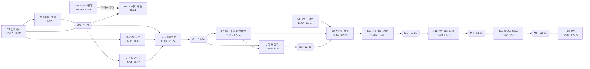

# 청사진 · 가상 데이터 단계 (소프트웨어 파이프라인)

> 작성: 2026-10-27 · 작성자: 총괄 팀장 · 상태: **초안 (메인 검증 전)**
> 상위 문서: [중심주제](../중심주제.md) · [비교-선정 §000](../0_방법탐색/비교-선정.md) · [M54](../0_방법탐색/후보/M54.md) · [M03](../0_방법탐색/후보/M03.md)
> 하위 문서: [세부청사진 T0](세부청사진_T0_Plane정리.md) · [세부청사진 T1](세부청사진_T1_하드웨어데이터명세.md) · [세부청사진 T2](세부청사진_T2_측정실패사례.md) · T3 이후는 G0 게이트 뒤에 작성

---

## 0. 문서 체계

| 층 | 문서 | 쓰는 사람 | 언제 |
|---|---|---|---|
| 1 | 이 청사진 (최종 목표·작업 목록·게이트) | 팀장 | 단계 시작 때, 게이트마다 갱신 |
| 2 | `docs/운영/세부청사진_T<n>_<이름>.md` | 팀장 | 작업 착수 전 |
| 3 | `docs/운영/대조/T<n>_대조표.md` (시작 확인 + 종료 대조) | 담당 worker | 착수 직후 · 종료 때 |
| 4 | `docs/운영/점검일지.md` (팀장 판정, 덧붙이기만) | 팀장 | worker 보고마다 |
| 5 | `docs/검토-기록.md` (중심주제 §6 여섯 질문) | worker 초안 → 팀장 확인 | 작업 완료 때 |

- 보고는 모두 팀장을 거칩니다. worker → 팀장(대조·판정) → 메인(커밋·Plane) → 본인.
- 대조표와 팀장 판정이 없으면 "완료"라고 쓰지 않습니다.

## 1. 출발점 (2026-10-27 확정 결정)

| 결정 | 내용 | 이 단계에 주는 영향 |
|---|---|---|
| 측정 방식 | 노즐 장착 라인 레이저 (M54 계열). OV9281 1280×800 · 3 µm · 글로벌셔터, M12 f8 f/4, WD 50 mm, 배율 0.19, 450 nm 라인 레이저 수직 + 카메라 30°, 시야 약 20 mm, 심도 약 8 mm, σ 약 15 µm, 단차 Q 약 22 µm | 시뮬레이터와 처리 코드는 이 구성 하나만 다룹니다 |
| 교차검증 | BLTouch (σ 약 5 µm, 핀 지름 약 2 mm)로 단차 면 몇 점 + 필러게이지 0.2/0.3/0.4 mm 기준 단차 | 가상 BLTouch 데이터와 가상 필러게이지가 필요합니다 |
| 요구 | 높이 차이 0.2–0.4 mm. 0.2 mm 기준 4:1 → Q ≤ 50 µm, 10:1 → Q ≤ 20 µm (Q = \|치우침\| + 2σ) | 모든 정량 판정은 이 두 한계로 합니다 |
| 하드웨어 | **오프라인 하드웨어 작업 없음.** 하드웨어는 "했다고 가정"하고 원시 카메라 영상부터 가상 데이터로 만듭니다. 교정(D1–D5)도 가상 교정 데이터로 개발합니다 | 실물 구매·조립·촬영은 비범위 |
| Plane | 하드웨어 항목 20개 삭제, 남은 42개 + 신규 2개 (W063 F0 하드웨어 데이터 명세 · W064 J0 가상 센서 시뮬레이터) = 44개 | 작업마다 Plane 항목을 대응시킵니다 (§4.1) |

## 2. 최종 목표

**가상 원시 영상에서 출발해 G코드 기준과 비교한 단차 높이 오차를 µm와 불확도로 내는 파이프라인을 완성하고, 시뮬레이터가 숨겨 둔 참값으로 그 정확도를 증명한다. 실제 하드웨어 데이터가 같은 명세로 들어오면 코드 수정 없이 돌아가게 한다.**

### 2.1 단계 완료 조건 (측정 가능)

| ID | 조건 | 측정 방법 | 목표 | 현재 값 (10-27) |
|---|---|---|---|---|
| C1 | 하드웨어 데이터 명세 v1.0 동결 | T1 세부청사진 검증 명령 | 7묶음 전부 정의, 삭제 20항목 대응 20/20, T2 참조 필드 누락 0 | 문서 없음 |
| C2 | 측정 실패사례 분석 완료 | T2 세부청사진 검증 명령 | 체크리스트 처리 100 %, 12범주 전부 항목 ≥ 1, 빈칸 0, 고유 출처 ≥ 20 | 문서 없음 |
| C3 | 가상 센서 시뮬레이터 v1 | 명세 검증기 + 시드 재현 시험 | 명세 검증기 통과 100 %, 같은 시드 → 같은 바이트, T2의 심각도 4·5 요인 전부 켜고 끌 수 있음 (또는 미반영 사유) | 코드 없음 |
| C4 | 가상 교정 D1–D5 | 채점기 (참값 대비) | D1 재투영 RMS < 0.2 px. 교정 결과로 잰 필러게이지 단차 0.2/0.3/0.4 mm의 Q ≤ 50 µm (필수) · ≤ 20 µm (목표) | 코드 없음 |
| C5 | 종단 정확도 | 채점기 (참값 대비) | 명목 잡음에서 0.2/0.3/0.4 mm 단차 복원 Q ≤ 50 µm (필수) · ≤ 20 µm (목표). 잡음·실패 요인을 모두 끈 조건에서 알고리즘 편향 ≤ 2 µm (안, T10에서 확정) | 코드 없음 |
| C6 | 실패 요인 민감도 지도 | 요인별 강도 스윕 | 심각도 4·5 요인마다 "Q가 50 µm·20 µm를 넘는 강도" 표 | 없음 |
| C7 | 가상 BLTouch 교차검증 | Bland–Altman | 레이저 단차와 BLTouch 단차의 평균 차가 합성 확장불확도(k=2) 안 | 없음 |
| C8 | 불확도 예산·MSA (가상) | I1·I2 계산 | 높이 불확도 예산표 1부, 가상 반복 측정 %GRR·ndc 계산 | 없음 |
| C9 | 실측 전환 준비 | 체크리스트 | 시뮬레이터 가정 목록 (실측으로 확인할 가정) + 실측 폴더를 넣고 돌리는 절차 1부 | 없음 |
| C10 | 운영 기록 | 파일 확인 | 모든 작업에 대조표·점검일지·검토기록·커밋·Plane Done | 0 / 14 |
| C11 | Plane 정리 | T0 세부청사진 검증 명령 | 안내 페이지 7개 (상위 1 + 하위 6), 항목 44개 상태·기간·모듈이 이 청사진 일정과 일치, 삭제 항목 참조 0 | 페이지 0, 상태 비어 있음 |

> **해석 주의.** 가상 데이터로 얻은 Q는 "알고리즘이 시뮬레이터가 넣은 오차를 얼마나 복원하는가"입니다. 하드웨어 성능의 증거가 아닙니다. 모든 결과 문서에 이 문장을 넣습니다.

## 3. 범위와 비범위

| 범위 (이번 단계에서 함) | 비범위 (하지 않음) |
|---|---|
| 데이터 명세, 실패사례 분석 | 부품 구매, 조립, 실제 촬영, 펌웨어 실기 연동 |
| 원시 영상부터 만드는 가상 센서 시뮬레이터 | 레이저 안전 실무 (실측 전환 때 다시 연다) |
| 가상 교정 D1–D5 알고리즘 | 윤곽·치수용 M108·M112 장비 |
| 라인 추출 → 삼각측량 → 높이맵 → 정합 → 단차 지표 → 보고 | G5 CAD 기준 관계, K6 학습 로드맵 (보류) |
| 가상 BLTouch·필러게이지 교차검증 | M6 최종 보고서·논문 (다음 단계) |
| 불확도 예산·MSA 틀 (가상 반복 측정) | 실측 성능 주장 |
| H6 윤곽·H7 치수 지표는 **선택** (시간이 남으면) | |

## 4. 작업 목록

### 4.1 작업표

| ID | 작업 | Plane 항목 (요소 코드) | 주 산출물 | 기간 | 선행 | 세부청사진 |
|---|---|---|---|---|---|---|
| **T0** | Plane 정리 (안내 페이지 7개, 항목 44개 상태·기간·모듈·옛 참조) | 44개 전체 (관리) | Plane 페이지 · `docs/운영/plane/` 스냅숏 | T0a 10-28 ~ 10-29 · T0b 11-04 | 메인의 운영 문서 커밋 | [있음](세부청사진_T0_Plane정리.md) |
| **T1** | 하드웨어 데이터 명세 | **F0 (W063)** · F3 (명세 부분) | `docs/하드웨어-데이터-명세.md` | 10-27 ~ 11-03 | T2 (필드 반영) | [있음](세부청사진_T1_하드웨어데이터명세.md) |
| **T2** | 측정 실패사례 분석 | 없음 → 신설 제안 (§10) | `docs/측정-실패사례.md` | 10-27 ~ 10-30 | 없음 | [있음](세부청사진_T2_측정실패사례.md) |
| T3 | 가상 센서 시뮬레이터 | **J0 (W064)** · B1 · B2 · E2 | `src/cvlab/sim/`, 가상 캠페인 데이터 1세트 | 11-04 ~ 11-24 | T1, T2, T5 | G0 뒤 작성 |
| T4 | G코드 기준 모델 | G1 · G2 · G3 · G4 | `src/cvlab/gcode_parser.py` 등, 기준 높이맵·마스크 | 11-04 ~ 11-17 | 없음 (방법 무관) | G0 뒤 작성 |
| T5 | 가상 시편 설계 | E3 | 시편 형상 목록 CSV, 시편 G코드 | 11-02 ~ 11-06 | T2 | G0 직전 작성 |
| T6 | 소프트웨어 구조·설정·명세 검증기 | J1 · J2 · F3 (구현) | 저장소 골격, `config/`, 명세 검증기 스크립트 | 11-04 ~ 11-10 | T1 | G0 뒤 작성 |
| T7 | 라인 추출·삼각측량·좌표계 | F1 · C4 | `src/cvlab/triangulation.py` | 11-25 ~ 12-04 | T3, T6 | G1 뒤 작성 |
| T8 | 가상 교정 | D1 · D2 · D3 · D4 · D5 | `src/cvlab/calibration/`, 교정 결과 YAML | 11-25 ~ 12-15 | T3, T7 (D2부터) | G1 뒤 작성 |
| T9 | 높이맵·전처리·정합 | H1 · H2 · H3 · H4 | `preprocess.py`, `registration.py` | 12-02 ~ 12-22 | T4, T7, T8 (D4) | G1 뒤 작성 |
| T10 | 단차 지표·리포트·합성 종단 시험 | H5 · J3 · J4 · M3 (H6·H7 선택) | `metrics.py`, `report.py`, 종단 시험 | 12-16 ~ 12-28 | T9 | G2 뒤 작성 |
| T11 | 시편 1개 완주 + 가상 BLTouch 교차검증 | I3 · M4 | 시편 1개 보고서, Bland–Altman | 12-29 ~ 01-11 | T10 | M3 뒤 작성 |
| T12 | 불확도·MSA·통계 | I1 · I2 · H8 · M5 | 불확도 예산, %GRR | 01-12 ~ 02-01 | T11 | M4 뒤 작성 |
| T13 | 단계 결산·실측 전환 준비 | K1 · K4 · K5 · A1 · A2 (갱신) | 결산 문서, 실측 전환 체크리스트 | 02-02 ~ 02-05 | T12 | M5 뒤 작성 |

- Plane 44개 대응: 위 표에 41개, 비범위·보류 3개 (G5, K6, M6). 빠진 항목은 없습니다.
- **W번호**: W063·W064만 확정입니다. 나머지 W번호는 Plane sequence_id라서 메인이 Plane에서 확인해 이 표에 채웁니다. 그전까지는 요소 코드로 부릅니다.
- 표의 날짜는 월-일입니다. 10월·11월·12월은 2026년, 01월·02월은 2027년입니다.

### 4.2 순서와 의존



- 주 경로: T2 → T1 → G0 → T3 → G1 → T7 → T8 → T9 → T10 → T11 → T12 → T13.
- **T0는 최우선**이고 다른 작업과 병행합니다. 주 경로를 막지 않습니다. 페이지 ⑤⑥만 G0 뒤에 채웁니다 (T0b).
- 병행: T4는 방법과 무관해 G0 전에 당겨도 됩니다. T5·T6은 T3를 막지 않게 먼저 끝냅니다.
- T9의 H1–H3은 T7 결과로 12-02에 먼저 시작합니다. 교정 결과가 필요한 H4 정합은 G2 (12-15) 뒤에 마무리합니다.
- T1과 T2는 동시에 시작합니다. T1은 10-31 ~ 11-02에 T2 결과(탐지 필드)를 넣는 단계를 따로 둡니다.

### 4.3 T3 이후 개요 (세부청사진은 아직 없음)

| ID | 목적 | 핵심 내용 | 완료 기준 (안) |
|---|---|---|---|
| T3 | 원시 영상부터 가상 데이터를 만든다 | 참값 형상 (시편 G코드 + 출력 오차 주입) → 레이저 선 렌더 (스펙클·흐림·산란·포화·잡음) → 카메라 영상 → 위치 로그 (지터·지연·흔들림) → 교정 원자료 (ChArUco·평판·필러게이지) → BLTouch 점 → 참값은 `_truth/`로 분리. 실패 요인은 T2 ID로 켜고 끔 | 명세 검증기 통과 100 %. 시드 재현. 심각도 4·5 요인 반영률 100 % (미반영은 사유). 처리 코드와 **다른 순방향 모델** 사용 (역범죄 방지, §5.2) |
| T4 | G코드에서 기준을 만든다 | G1 파싱 → G2 비드 모델 → G3 층별 마스크·기준 높이맵 → G4 비교 영역 (엣지 띠 제외) | 손으로 쓴 10줄 G코드 단위 시험 통과 (J3 예), 시편 G코드의 단차 면 높이가 설계값과 일치 |
| T5 | 0.2/0.3/0.4 mm 단차를 담은 가상 시편 | 단차 면 폭 ≥ 3 mm (BLTouch 핀), 시야 20 mm 안, 가림 폭 h·tan30° 반영, 필러게이지 배치 | 형상 목록 CSV + G코드 + 면별 BLTouch 점 위치 |
| T6 | 저장소 골격과 명세 검증기 | J1 폴더 구조, J2 설정·시드·버전 기록, 명세 검증기 (`scripts/validate_dataset.py`) | 검증기가 T1 명세의 필수 필드·자료형·범위를 모두 검사. 고장 표본 (필드 누락·단위 오류) 탐지 100 % |
| T7 | 원시 영상 → 3D 점 | F1 서브픽셀 중심 추출 (무게중심부터), 포화·다중 피크 처리, C4 좌표계 {C}{S}{M}{G} | 정지 평판 100장 반복성 표, 채점기 기준 프로파일 오차 표 |
| T8 | 가상 교정 | D1 카메라 내부, D2 레이저 평면, D3 스캔 축, D4 노즐-센서 오프셋·{M}→{G}, D5 필러게이지 검증·교정 ID 이력 | C4 조건 (§2.1). 교정 파라미터가 참값과 다를 때 높이에 미치는 영향 표 |
| T9 | 3D 점 → 비교 가능한 높이맵 | H1 격자화, H2 이상치, H3 베드 기준화, H4 정합 (마커·노즐 오프셋) | 알려진 이동·회전 복원 (J3 조건), 결측을 보간으로 채우지 않음 |
| T10 | 단차 지표와 종단 시험 | H5 단차 높이·면 평균, J3 합성 변형 복원, J4 히트맵·단면·보고서 | C5 조건. M3 통과 |
| T11 | 시편 1개 완주와 교차검증 | 원시 영상 → 보고서 한 번에, 가상 BLTouch·필러게이지 비교, Bland–Altman | C7 조건. M4 통과 |
| T12 | 불확도와 MSA | I1 요인별 불확도 (가상 요인 강도에서 계산), I2 반복성·재현성·%GRR, H8 시편 단위 통계 | C8 조건. M5 통과 |
| T13 | 결산 | K1 일정·K4 위험·K5 산출물 갱신, A1·A2 수치 정리, 실측 전환 체크리스트, 시뮬레이터 가정 목록 | C9·C10 조건 |

## 5. 직원 배치

### 5.1 배치표

| 작업 | 담당 worker | 모델 | effort | 독립 검증 | 투입 시점 |
|---|---|---|---|---|---|
| T0 | Plane 담당 (Plane MCP 도구 사용) | Opus 5.5 | medium | 팀장 (메인이 따로 받은 검증용 스냅숏으로) | 메인의 운영 문서 커밋 직후 (10-28) |
| T1 | 명세 담당 | Opus 5.5 | medium | 팀장 | 10-27 |
| T2 | 조사 담당 | Opus 5.5 | medium | 팀장 (출처 표본 10개 원문 대조) | 10-27 |
| T3 | 시뮬레이터 담당 | Opus 5.5 | medium (1차 미달 시 high 요청 후보) | 검증 담당 (참값·시드 재현 시험) + 팀장 | G0 통과 직후 |
| T4 | 기준모델 담당 | Opus 5.5 | medium | 팀장 | 11-04 (당길 수 있음) |
| T5 | 기준모델 담당 | Opus 5.5 | medium | 팀장 | 11-02 |
| T6 | 명세 담당 | Opus 5.5 | medium | 팀장 (고장 표본 탐지 시험) | G0 통과 직후 |
| T7 | 광학처리 담당 | Opus 5.5 | medium | 팀장 + 채점기 | G1 통과 직후 |
| T8 | 교정 담당 | Opus 5.5 | medium (1차 미달 시 high 요청 후보) | 팀장 + 채점기 | G1 통과 직후 |
| T9 | 분석 담당 | Opus 5.5 | medium | 팀장 + 채점기 | 12-02 |
| T10 | 분석 담당 | Opus 5.5 | medium | 검증 담당 + 팀장 | 12-16 |
| T11 | 검증 담당 | Opus 5.5 | medium | 팀장 | M3 통과 직후 |
| T12 | 검증 담당 | Opus 5.5 | medium | 팀장 | M4 통과 직후 |
| T13 | 조사 담당 | Opus 5.5 | medium | 팀장 | M5 통과 직후 |

- 모든 worker는 `worker` 타입, 모델 Opus 5.5입니다. 호출 도구로 effort를 지정할 수 없으면 지시문 첫 줄에 "effort medium"을 적습니다.
- **effort 상향 기준** (팀장이 메인에게 요청, 본인 승인 뒤 적용): 한 보고에서 통과 조건 2개 이상 미달, 또는 재작업 뒤 같은 조건 재미달. 이력은 점검일지에 남깁니다.
- 한 worker가 동시에 두 작업을 맡지 않습니다. 같은 파일을 두 worker가 동시에 고치지 않습니다.

### 5.2 정보 차단 (역범죄 방지)

같은 모델로 데이터를 만들고 같은 모델로 되풀면 결과가 지나치게 좋게 나옵니다 (inverse crime). 그래서 아래를 지킵니다.

| 규칙 | 내용 |
|---|---|
| 사람 분리 | 시뮬레이터 담당은 처리 코드(T7–T12)를 맡지 않습니다 |
| 참값 차단 | 처리 담당은 `data/_truth/`와 `src/cvlab/sim/` 내부를 읽지 않습니다. 정확도는 **채점기**(지표만 출력)로만 봅니다 |
| 모델 분리 | 시뮬레이터는 처리 코드보다 정밀한 순방향 모델을 씁니다 (예: 체적 산란·스펙클·렌즈 왜곡 고차항·타이밍 지터). 처리 코드는 핀홀+평면 모델 같은 단순 모델로 되풉니다. 차이 목록을 T3 산출물에 적습니다 |
| 블라인드 세트 | 시뮬레이터는 개발용 세트와 **팀장만 시드를 아는 평가용 세트**를 따로 만듭니다. C4·C5 판정은 평가용 세트로 합니다 |

## 6. 단계 게이트

| 게이트 | 날짜 | 통과 조건 | 확인 방법 | 못 넘으면 |
|---|---|---|---|---|
| **G0** 명세·실패사례 동결 | 11-03 | C1·C2 충족. T2 심각도 상위 10개가 T1 필드와 T3 반영표에 연결됨 | T1·T2 검증 명령, 팀장 표본 검사 | T3 착수 연기. 미달 항목만 재작업 (최대 2일) |
| **G1** 시뮬레이터 v1 | 11-24 | C3 충족. 가상 캠페인 1세트 (교정 원자료 + 시편 스캔 + BLTouch + 반복 측정) 생성 | 명세 검증기, 시드 재현 시험, 참값 분리 확인 | T7·T8은 시뮬레이터 부분 결과 (프레임만)로 먼저 시작, 나머지 보완 |
| **G2** 가상 교정 통과 | 12-15 | C4 충족 (옛 M1·M2 기준을 가상 데이터로 대체) | 채점기 (평가용 세트) | 원인 분석 → 교정 알고리즘 또는 시뮬레이터 가정 재검토 (본인 보고) |
| **M3** 합성 변형 복원 | 12-28 | J3 조건: 이동 (0.20, −0.10) mm · 회전 0.5° · 배율 0.996 · 높이 +0.03 mm 복원, 허용치는 T10 세부청사진에서 확정 | 종단 시험 | T11 연기 |
| **M4** 시편 1개 완주 | 2027-01-11 | 원시 영상 → 보고서 1회 실행. C5·C7 충족 | 실행 기록 + 채점기 | 막힌 단계부터 재작업 |
| **M5** 불확도·MSA | 2027-02-01 | C8 충족 | I1·I2 계산 검토 | T13에 한계로 기록 |

- 게이트 판정은 팀장이 점검일지에 적고, 메인이 본인에게 보고합니다. 게이트에서 목표 수치를 바꾸려면 본인 결정이 필요합니다.

## 7. 대조 절차

모든 작업이 같은 8단계를 밟습니다.

| 단계 | 누가 | 무엇을 | 어디에 |
|---|---|---|---|
| 1. 착수 준비 | 팀장 | 세부청사진 작성. 메인이 확인 후 worker 투입 | `docs/운영/세부청사진_T<n>_*.md` |
| 2. Plane 착수 | 메인 | 해당 항목 상태 ToDo → **InProgress** | Plane LTGE |
| 3. 시작 확인 | worker | `git pull` 결과, 금지 파일 상태, 목표를 자기 말로 다시 쓰기, 입력 파일 존재 확인 | `docs/운영/대조/T<n>_대조표.md` 의 "시작 확인" 절 |
| 4. 실행 | worker | 세부청사진의 단계대로. 범위를 바꾸고 싶으면 멈추고 팀장에게 보고 | 산출물 경로 |
| 5. 종료 대조 | worker | 목표 항목마다 결과·근거 위치·자기 판정. 검증 명령 실행 결과 첨부 | 같은 대조표의 "종료 대조" 절 |
| 6. 팀장 검증 | 팀장 | 보고를 믿지 않고 파일을 직접 엽니다. 검증 명령 재실행, 수치 재계산, 표본 검사 (출처 원문 대조 등). 항목별 ○/△/✗ | `docs/운영/점검일지.md` (덧붙이기만) |
| 7. 커밋·푸시 | 메인 | 팀장 판정에 ✗가 없을 때만. `git pull --ff-only` → **산출물 경로를 하나씩 지정해** `git add` → 커밋 → 푸시 | 원격 브랜치 |
| 8. Plane 반영 | 메인 | 상태 **Done**, 댓글에 커밋 해시·대조표 경로. ✗ 재작업이면 InProgress 유지 | Plane LTGE |

### 7.1 판정 기호

| 기호 | 뜻 | 다음 행동 |
|---|---|---|
| ○ | 통과 조건 충족, 근거 확인함 | 다음 단계 |
| △ | 대체로 충족, 경미한 누락 (수치 영향 없음) | 같은 worker가 보완, 커밋은 가능 |
| ✗ | 미달, 근거 없음, 숫자 불일치 | 커밋 금지. 같은 worker에 재작업 지시 (미달 목록 첨부) |

### 7.2 종료 대조표 양식 (모든 작업 공통)

```markdown
## 종료 대조 (YYYY-MM-DD HH:MM)

| 목표 항목 | 결과 | 근거 위치 | 판정 |
|---|---|---|---|
| (세부청사진 목표 번호와 문장) | (실제 값·개수) | (파일:줄 또는 명령 출력) | ○/△/✗ |

검증 명령 실행 결과: (출력 붙여 넣기)
남은 문제: (없으면 "없음")
```

### 7.3 커밋 규칙

- 커밋 메시지: `T<n>: <영문 요약> (W<번호>)` 한 줄 + 빈 줄 + 산출물 목록 + `Co-Authored-By: Claude Opus 5.5 <noreply@anthropic.com>`.
- `git add -A`, `git add .`, `git commit -a`, `git stash`, `git checkout -- .`, `git restore .`, `git clean`, `git reset --hard` **금지**. V2 미커밋 변경이 사라집니다.

## 8. 모든 worker 공통 규칙

| 구분 | 규칙 |
|---|---|
| 건드리지 않는 파일 | `scripts/method_screening/*` (rules.py · scoring.py · screen.py · simulate.py · specs.py · v3.py), `tests/test_method_screening.py`, `docs/0_방법탐색/결과_v3/` — V2 재검증 미커밋 변경. 읽기만 허용 |
| 새 시험 파일 | `tests/test_<모듈>.py` 새 파일로 만듭니다. 기존 시험 파일은 고치지 않습니다 |
| 커밋 | worker는 커밋·푸시하지 않습니다. 메인이 팀장 판정 뒤에 합니다 |
| 숫자 | 숫자마다 근거 표시: `[출처 n]` (URL 목록 번호) · `[계산]` (식을 함께) · `[추정]` (이유를 함께) · `[미상]`. 근거 없는 숫자 금지 |
| 단위·좌표 | 길이 mm (작은 값은 µm 허용, 필드명 접미사로 표시), 시각 ns 정수, 온도 °C, 각도 내부 rad·보고 °. 좌표계는 C4의 {C}{S}{M}{G}를 씁니다 |
| 층 번호 | 0부터 셉니다 (C2 규칙) |
| 문서 | 한국어. 짧은 문장. 비교는 표. 영어 문장을 옮긴 번역투 금지 |
| 보고 | 팀장에게만 보고합니다. 완료 보고에는 대조표 경로를 꼭 넣습니다 |

## 9. 위험과 대응

| 위험 | 영향 | 대응 |
|---|---|---|
| 역범죄로 가상 성능 과대평가 | 실측에서 목표 미달 | §5.2 정보 차단, 블라인드 평가 세트, 시뮬레이터 가정 목록 (C9) |
| 시뮬레이터가 실제 실패 요인을 빠뜨림 | 같은 이유 | T2 체크리스트를 T3 반영표로 강제 연결 (G0 조건) |
| 명세가 실측 장비와 안 맞음 (예: USB 카메라가 원시 프레임을 못 냄) | 실측 전환 때 재작업 | T2가 장비 제약을 찾아 T1 필드로 넣음 (`frame.pixel_format`, `frame.lossy` 등) |
| V2 미커밋 코드 손상 | 재검증 작업 유실 | §7.3 금지 명령, §8 금지 파일, 커밋 때 경로 지정 |
| T1·T2 일정 겹침 | T1이 T2를 기다림 | T1은 필드 골격을 먼저 쓰고 10-31 ~ 11-02에 T2를 반영 |
| 웹 검색 한도 (10-08에 200회 소진 이력) | 출처 부족 | T2 검색 예산 60회 안, 단서 목록부터 확인 |
| 범위 확장 (윤곽·치수까지) | 일정 지연 | H6·H7은 선택. 바꾸려면 본인 결정 |
| Plane 본문 동시 편집 (T0와 "가상 데이터 기준" 안내 worker) | 한쪽 수정이 덮어써짐 | T0는 그 11개 항목 본문을 메인 확인 전 손대지 않음. 정리 전 백업 스냅숏 필수 |
| Plane과 저장소 내용 어긋남 | 잘못된 정보로 작업 | 저장소가 원본. Plane 페이지는 요약 + 링크, 첫 줄에 기준일 |

## 10. 결정 대기

| 번호 | 내용 | 누가 | 기한 |
|---|---|---|---|
| D-01 | T2용 Plane 항목 신설 여부 (제안: `[M0][C0W065][RES] 측정 실패사례 분석`, 기한 10-30) | 본인 (메인 경유) | 10-28 |
| D-02 | 나머지 42개 W번호를 §4.1 표에 기입 (T0 S3 대응표를 재료로) | 메인 | 10-29 |
| D-03 | T0가 G5·K6·M6·H6·H7을 Backlog로 둠. 반대하면 되돌림 | 본인 확인 | G0 |
| D-04 | 측정 시점 기본값: 층별(공정 중) 측정을 주로 할지, 출력 후 베드 위 측정을 주로 할지. T2 결과를 보고 G0에서 결정 (시뮬레이터 시나리오 우선순위가 달라짐) | 본인 | G0 (11-03) |

## 11. 변경 이력

| 날짜 | 내용 |
|---|---|
| 2026-10-27 | 초안. T1·T2 세부청사진 함께 작성 |
| 2026-10-27 | 메인 요청으로 T0 (Plane 정리, 최우선) 추가. C11 조건, 배치표, 위험 2건 추가 |
