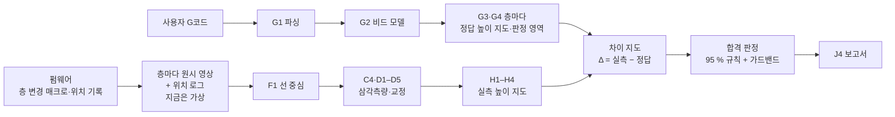
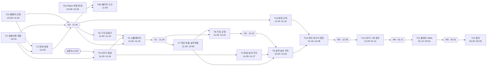

# 청사진 · 가상 데이터 단계 (G코드 대비 높이 판정 워크플로우)

> 작성: 2026-10-27 · **개정: 2026-10-27 (목표 재정의)** · **결정 반영: 2026-10-27 (D-05–D-08 확정)** · 작성자: 총괄 팀장 · 상태: **개정판 (메인 검증 전)**
> 상위 문서: [중심주제](../중심주제.md) · [비교-선정 §000](../0_방법탐색/비교-선정.md) · [M54](../0_방법탐색/후보/M54.md) · [M03](../0_방법탐색/후보/M03.md)
> 하위 문서: [세부청사진 T0](세부청사진_T0_Plane정리.md) · [세부청사진 T1](세부청사진_T1_하드웨어데이터명세.md) · [세부청사진 T2](세부청사진_T2_측정실패사례.md) (셋 다 2026-10-27 개정) · [세부청사진 T14](세부청사진_T14_펌웨어선정.md) (2026-10-27) · [팀장검증 T0–T2](팀장검증_T0-T2.md) · 나머지는 게이트 뒤 작성

---

## 개정 요약 (2026-10-27, 사용자 확정)

| 구분 | 이전 | 개정 |
|---|---|---|
| 최종 산출물 | 단차 높이를 µm로 복원하는 파이프라인 | G코드 → 정답 높이 지도, 레이저(층마다) → 실측 높이 지도, 차이 → 합격 판정 → 보고서로 이어지는 **워크플로우** |
| 0.2–0.4 mm의 뜻 | 찾아낼 단차 크기 | **허용 오차 T**. G코드 대비 높이 차이가 이 안이면 합격. **T = 0.2 mm 고정 (D-05 확정)** |
| 비교 대상 | 한 스캔 안 두 면의 차이 (단차) | **G코드 대비 절대 높이**. 두 면에 같이 들어가 빠지던 공통 오차가 이제 남음 (§1.2) |
| 측정 요구 | 단차 Q ≤ 50 µm (4:1) · ≤ 20 µm (10:1) | 절대 높이 **U ≤ 50 µm (4:1) · ≤ 20 µm (10:1)**, T = 0.2 mm 기준 |
| 판정 | 없음 | 전체 층을 합쳐 측정점의 95 % 이상이 허용 오차 안이면 합격 (D-08). 가드밴드 방식 B로 합격·불합격·보류 (D-07). 측정 당시 높이로 판정 (D-06). §2.3 |
| 정답 데이터 | 따로 설계하는 가상 시편 | **사용자 G코드** (경로 받는 중). E3는 점검·보조 시편으로 축소 |
| 새 작업 | - | **T14 펌웨어 선정**, **T15 합격 판정 규칙** |
| 유지 | 층마다 측정 · 예산 100만 원 미만 · 지금은 가상, 나중에 실측으로 교체 · 처리 담당은 참값을 보지 않음 · Plane은 보고용 | |

### 결정 반영 (2026-10-27, 본인 확정)

| 번호 | 결정 | 반영한 곳 |
|---|---|---|
| D-05 | 허용 오차 T = 0.2 mm 고정 | 개정 요약 · §1 · §1.1 · §2 · §10 |
| D-06 | 측정 당시 높이로 판정. 마지막 층은 식힌 뒤 다시 재서 차이를 확인 | §2.3 · §9 · §10 |
| D-07 | 가드밴드 방식 B (합격·불합격·보류) | §2.3 · §10 |
| D-08 | 95 % 규칙은 전체 층을 합산해 적용 | §2.3 · §4.3 (T15) · §10 |
| 유지 | 층마다 측정, 예산 100만 원 미만, 지금은 가상 데이터, Plane은 보고용 | §1 |

## 0. 문서 체계

| 층 | 문서 | 쓰는 사람 | 언제 |
|---|---|---|---|
| 1 | 이 청사진 (최종 목표·작업 목록·게이트) | 팀장 | 단계 시작 때, 게이트마다, 목표가 바뀔 때 |
| 2 | `docs/운영/세부청사진_T<n>_<이름>.md` | 팀장 | 작업 착수 전 |
| 3 | `docs/운영/결과_T<n>_대조표.md` (시작 확인 + 종료 대조) | 담당 worker | 착수 직후 · 종료 때 |
| 4 | `docs/운영/점검일지.md` (팀장 판정, 덧붙이기만) | 팀장 | worker 보고마다 |
| 5 | `docs/검토-기록.md` (중심주제 §6 여섯 질문) | worker 초안 → 팀장 확인 | 작업 완료 때 |

- 보고는 모두 팀장을 거칩니다. worker → 팀장(대조·판정) → 메인(커밋·Plane) → 본인.
- 대조표와 팀장 판정이 없으면 "완료"라고 쓰지 않습니다.
- 대조표 정본 경로는 3층의 `결과_T<n>_대조표.md` 하나입니다. 예전 표기 `docs/운영/대조/…`는 쓰지 않습니다.

## 1. 출발점

| 결정 | 내용 | 이 단계에 주는 영향 |
|---|---|---|
| 목표 (10-27 개정) | 사용자 원문: "소프트웨어로 G코드 해석까지 한번에 될 거야. 나는 출력할 데이터의 G코드를 가지고 있어. 이 G코드를 정답 데이터로 설정하고, 레이저 삼각측량 방식으로 실측 데이터를 만들어서 이 2개를 비교할 거야. 100만 원 미만, 높이 오차 0.2~0.4 mm로 정량적으로 이 출력물이 오차 없이 잘 출력·측정되었는지 파악할 수 있는 워크플로우를 만들 거야." | 최종 목표 §2 |
| 측정 방식 | 노즐 장착 라인 레이저 (M54 계열). OV9281 1280×800 · 3 µm · 글로벌셔터, M12 f8 f/4, WD 50 mm, 배율 0.19, 450 nm 라인 레이저 수직 + 카메라 30°, 시야 약 20 mm, 심도 약 8 mm, σ 약 15 µm | 시뮬레이터와 처리 코드는 이 구성 하나만 다룹니다 |
| 허용 오차·측정 요구 (개정) | T = 0.2 mm 고정 (G코드 대비 높이 차이, D-05 확정). 측정 요구도 T = 0.2 mm에서 정함 (§1.1) | 모든 정량 판정은 U 한계로 합니다 |
| 판정 (개정) | 전체 층을 합쳐 측정점의 95 % 이상이 허용 오차 안이면 합격. 가드밴드 방식 B, 측정 당시 높이 기준 (D-06·D-07·D-08 확정) | T15 신설, §2.3 |
| 정답 데이터 (개정) | 사용자 G코드. 시편은 따로 설계하지 않음 | T4가 사용자 G코드로 정답 높이 지도를 만듦. T5 축소 |
| 측정 시점 | 층마다 (출력 중) 측정. D-04로 확정 | 층마다 정답 높이 지도와 비교 |
| 교차검증 | BLTouch (σ 약 5 µm, 핀 지름 약 2 mm)로 윗면 몇 점의 절대 높이 + 베드 위 필러게이지 0.2/0.3/0.4 mm (높이를 아는 기준) | 가상 BLTouch·필러게이지 데이터 |
| 펌웨어 (신설) | 사용자 프린터 펌웨어를 확인하고, 이 워크플로우에 가장 맞는 펌웨어를 고름. 비교 대상 Klipper · Marlin · RepRapFirmware 등 | T14 신설. 결과가 T1 위치 필드와 T3 위치 로그 모델에 들어감 |
| 하드웨어 | **오프라인 하드웨어 작업 없음.** 하드웨어는 "했다고 가정"하고 원시 카메라 영상부터 가상 데이터로 만듦. 교정(D1–D5)도 가상 교정 데이터로 개발 | 구매·조립·촬영·펌웨어 설치는 비범위 |
| 실측 데이터 | 지금은 가상. 나중에 실제 장비 데이터로 교체. 같은 명세(T1)를 씀 | 명세가 가상과 실측의 경계 |
| 예산 | 장비 100만 원 미만 (유지). M54 50만 (감사 상한 90만) + M03 5만 (5.6만) = 55만, 상한 95.6만 [계산] | 펌웨어 교체에 추가 장치가 필요하면 상한을 넘을 수 있음 (§9) |
| Plane | 보고용. 사람이 쓴 문체, 내부 용어 없음. 제목 형식 "D1. 작업명" (10-27 변경 완료). 항목 44개 | 작업마다 Plane 항목을 대응시킴 (§4.1) |

### 1.1 허용 오차와 측정 요구

| 허용 오차 T | U 한계 4:1 (필수) | U 한계 10:1 (목표) |
|---|---|---|
| **0.2 mm (설계 기준)** | **50 µm** | **20 µm** |
| 0.3 mm | 75 µm | 30 µm |
| 0.4 mm | 100 µm | 40 µm |

- U는 측정점 높이의 확장불확도 (k = 2)입니다. 보정하지 못한 치우침은 더합니다: U = |남은 치우침| + 2·u_c.
- 이전 Q와 식은 같습니다. 대상이 "단차"에서 "G코드 좌표계의 절대 높이 (베드 면 = 0)"로 바뀌었습니다.
- T는 0.2 mm로 고정합니다 (D-05 확정, 10-27). 설계·판정 모두 0.2 mm 행을 씁니다. 0.3·0.4 mm 행은 참고용입니다.

### 1.2 이제 빠지지 않는 공통 오차

단차는 한 스캔 안 두 면의 차이라서 두 면에 똑같이 들어가는 오차가 빠졌습니다. G코드 대비 절대 높이에서는 그대로 남습니다.

| 오차원 | 왜 남나 | 크기 감 (검증 전) | 다루는 작업 |
|---|---|---|---|
| Z축 (리드스크루 피치·워블, 홈 반복성) | 실측 높이 = 센서가 잰 거리 + 프린터 Z 위치 | [미상] (T2 MF-MEC-04) | T2 · T8 · T12 |
| 베드 기준 (Z = 0 면, 기울기·휨, 메시 보정) | 높이의 0점이 베드 면 | 기울기 0.1°면 20 mm에 34.9 µm (T2 MF-MEC-06 [계산]) | T8 · T9 (H3) |
| 열팽창·냉각 수축 | 시편이 식으면서 줄어듦 | PLA 높이 20 mm에서 약 50 µm (사용자 제시. 68 µm/(m·°C) × 20 mm × 약 37 °C ≈ 50 µm [계산]) | T2 · T12 · D-06 |
| 층별 측정 때 뜨거운 상태 | 측정 당시 높이 ≠ 식은 뒤 높이. 아래층은 식어 가고 맨 위층은 뜨거움 | 위와 같은 원인, 층마다 다름 | T3 · T15 · D-06 |
| 브래킷·프레임 열 드리프트 | 센서와 노즐 사이 거리가 바뀜 | 절대 13.8–21 µm (T2 MF-THM-01·08 [추정]) | T8 · T12 |
| 노즐-센서 Z 오프셋, 레이저 평면 절대 위치 | 교정 오프셋이 그대로 높이에 들어감 | [미상] | T8 (D2·D4) |

- 숫자는 T2 초안의 값과 사용자 제시값입니다. T2 개정에서 다시 매깁니다.

## 2. 최종 목표

**사용자 G코드에서 층마다 정답 높이 지도를 만들고, 층마다 레이저 삼각측량으로 잰 실측 높이 지도와 비교해, 전체 층을 합쳐 측정점의 95 % 이상이 허용 오차 T (0.2 mm) 안인지 판정하고 보고서로 내는 워크플로우를 완성한다. 지금은 가상 실측 데이터로 측정 정확도 (U ≤ 50 µm, 목표 20 µm)와 판정 정확도를 시뮬레이터가 숨겨 둔 참값으로 증명한다. 실제 장비 데이터가 같은 명세로 들어오면 코드 수정 없이 돌게 한다. 장비는 100만 원 미만.**

### 2.1 워크플로우



| 단계 | 입력 | 출력 | 작업 |
|---|---|---|---|
| 1 정답 | 사용자 G코드 | 층마다 정답 높이 지도 Z_ref(x, y, n), 판정 영역 마스크 | T5 → T4 (G1–G4) |
| 2 실측 | 층마다 원시 영상 + 위치 로그 (지금은 가상) | 층마다 실측 높이 지도 Z_meas(x, y, n), 베드 면 = 0 | T3 → T7 · T8 · T9 |
| 3 차이 | 1 · 2 | 차이 지도 Δ = Z_meas − Z_ref | T15 · T10 |
| 4 판정 | Δ, T, U | 합격 · 불합격 · 보류 · 측정 불충분 | T15 |
| 5 보고서 | 1–4 | 층별 차이 지도, 판정, 근거 수치, 해석 주의 문장 | T10 (J4) |
| 연동 | 펌웨어 | 층 변경 매크로, 위치·시각 기록 | T14 |

### 2.2 단계 완료 조건 (측정 가능)

| ID | 조건 | 측정 방법 | 목표 | 현재 값 (10-27 팀장 검증, [팀장검증_T0-T2](팀장검증_T0-T2.md)) |
|---|---|---|---|---|
| C1 | 하드웨어 데이터 명세 v1.0 동결 [개정] | T1 세부청사진 검증 명령 | 7묶음 정의, 삭제 20항목 20/20, T2 참조 필드 누락 0, **절대 높이·판정·펌웨어 필드 추가 (T1 G11–G14)** | 초안: 원래 기준 G1–G10 ○ 10/10 (필드 227행). 개정 G11–G12 미착수, G13–G14 보류 |
| C2 | 측정 실패사례 분석 완료 [개정] | T2 세부청사진 검증 명령 | 기존 조건 + **S를 절대 높이 기준으로 다시 매김, 절대 높이 오차 예산 (U), G코드 해석·판정·펌웨어·열 상태 항목 추가 (T2 R12–R17)** | 초안: 원래 기준 R1–R11 ○ 10 · △ 1 (R9 출처 8/10). 개정 R12–R17 미착수 (S는 단차 기준) |
| C3 | 가상 센서 시뮬레이터 v1 [개정] | 명세 검증기 + 시드 재현 시험 | 명세 검증기 100 %, 같은 시드 → 같은 바이트, T2 심각도 4·5 요인 켜고 끔 (또는 미반영 사유), **사용자 G코드 + 주입한 출력 오차로 참 형상 생성, 층마다 열 상태·Z축 오차 반영** | 코드 없음 |
| C4 | 가상 교정 D1–D5 [개정] | 채점기 (참값 대비) | D1 재투영 RMS < 0.2 px. 필러게이지 0.2/0.3/0.4 mm 윗면의 **베드 기준 절대 높이** U ≤ 50 µm (필수) · ≤ 20 µm (목표) | 코드 없음 |
| C5 | 종단 정확도 [개정] | 채점기 (참값 대비) | 명목 잡음에서 측정점 높이 (G코드 좌표계, 베드 = 0) U ≤ 50 µm (필수) · ≤ 20 µm (목표). 잡음·실패 요인을 모두 끈 조건에서 알고리즘 편향 ≤ 2 µm (안) | 코드 없음 |
| C6 | 실패 요인 민감도 지도 [개정] | 요인별 강도 스윕 | 심각도 4·5 요인마다 "U가 50 µm·20 µm를 넘는 강도" 표 | 없음 |
| C7 | 가상 BLTouch 교차검증 [개정] | Bland–Altman | 같은 점의 레이저 절대 높이와 BLTouch 절대 높이의 평균 차가 합성 U 안. 두 방식이 함께 쓰는 Z축 몫은 따로 표기 | 없음 |
| C8 | 불확도 예산·MSA (가상) [개정] | I1·I2 계산 | **절대 높이** 불확도 예산표 (§1.2 오차원 포함), 가상 반복 측정 %GRR·ndc, **판정에 쓰는 U 값 확정** | 없음 |
| C9 | 실측 전환 준비 | 체크리스트 | 시뮬레이터 가정 목록 + 실측 폴더를 넣고 돌리는 절차 + **펌웨어 설치·층 변경 매크로 확인 절차** | 없음 |
| C10 | 운영 기록 | 파일 확인 | 모든 작업에 대조표·점검일지·검토기록·커밋·Plane Done | 대조표 3개 (T0–T2), 점검일지 1절 (10-27), 운영 문서 커밋 없음 / 작업 16개 |
| C11 | Plane 정리 [개정] | T0 세부청사진 검증 명령 | 안내 페이지 7개, 항목 상태·기간·모듈 = 이 청사진, 삭제 항목 참조 0, **개정 목표·허용 오차 반영, 옛 단차 기준 표기 0, 새 항목은 본인 승인 뒤** | 원래 기준 P1–P10 ○ 9 · △ 1 (P3 깨진 링크 1). 개정 P11–P13 미착수, P14 미확인 (스냅숏이 제목 변경 전) |
| **C12** | 합격 판정 정확도 (신설) | 채점기 (참 판정 대비) | 판정 시험 세트 (합격·경계·불합격 시나리오, T5)에서 참 불합격을 합격으로 판정 **0건** (필수). 참 합격을 불합격으로 ≤ 5 % (안). 보류 비율 보고 | 없음 |
| **C13** | 펌웨어 선정 (신설) | T14 세부청사진 검증 | 사용자 프린터 현재 펌웨어 기록, 후보 ≥ 3개 × 기준 7개 비교표 (칸마다 출처 또는 [미상]), 선정 1개와 이유, 층 변경 매크로 초안, T1에 줄 필드 (T14 FW1–FW12) | 없음 |
| **C14** | 워크플로우 완주 (신설) | 실행 기록 | 사용자 G코드 1개로 정답 높이 지도 → 가상 실측 (층마다) → 차이 지도 → 판정 → 보고서를 명령 한 번에 실행 | 없음 |

> **해석 주의.** 가상 데이터로 얻은 U와 판정 정확도는 "알고리즘이 시뮬레이터가 넣은 오차를 얼마나 복원하는가"입니다. 하드웨어 성능의 증거가 아닙니다. 모든 결과 문서와 보고서에 이 문장을 넣습니다.

### 2.3 판정 규칙과 가드밴드 (본인 확정 D-05–D-08, 2026-10-27)

| 항목 | 확정 내용 | 결정 |
|---|---|---|
| 허용 오차 | T = 0.2 mm 고정 | D-05 |
| 판정 기준 상태 | 측정 당시 높이로 판정. 마지막 층은 식힌 뒤 다시 재서 차이를 확인 | D-06 |
| 가드밴드 | 방식 B (합격·불합격·보류) | D-07 |
| 95 % 적용 단위 | 전체 층 합산 | D-08 |

| 방식 | 출력물 합격 조건 | 장점 | 단점 |
|---|---|---|---|
| A 가드밴드 없음 | 측정점의 95 % 이상이 \|Δ\| ≤ T | 단순 | 경계 근처 불량을 합격으로 볼 위험 (최대 U만큼) |
| **B 점 단위 가드밴드 + 보류 (확정, D-07)** | 아래 두 표 | 오합격 위험을 U로 막음 (ISO 14253-1식 적합 판정) | 보류가 생김 |
| C 비율 신뢰구간 | 합격점 비율의 신뢰 하한 ≥ 95 % | 통계로 엄밀 | 점 사이 상관을 추정해야 해 복잡 |

**B를 고른 이유.** 본인 목표가 "오차 없이 잘 출력되었는지"를 정량으로 가리는 것이라, 불량을 합격으로 내보내는 쪽이 더 나쁜 실수입니다. B는 그 위험을 U로 막고, 애매한 경우를 숨기지 않고 "보류"로 드러냅니다.

| 점 분류 | 조건 |
|---|---|
| 합격점 | \|Δ\| ≤ T − U |
| 불합격점 | \|Δ\| > T + U |
| 보류점 | 그 사이 |

| 출력물 판정 | 조건 (전체 층의 유효 측정점을 합산, D-08) |
|---|---|
| 합격 | 합격점 ≥ 95 % |
| 불합격 | 불합격점 > 5 % |
| 보류 | 그 밖 (재측정 또는 사람이 판단) |
| 측정 불충분 | 유효 측정점 < 판정 영역의 90 % (안, T15에서 확정) |

- 예: T = 0.2 mm, U = 30 µm면 합격점 \|Δ\| ≤ 0.17 mm, 불합격점 \|Δ\| > 0.23 mm.
- U는 처음에는 시스템 전체 값 하나 (C5 결과의 최댓값)를 씁니다. 점마다 다른 U는 T12 뒤 검토합니다.
- 보고서에는 방식 A 결과도 참고로 같이 적습니다.
- 측정점 = 판정 격자 한 칸. 크기는 T15에서 정합니다 (안: 0.2 mm). 비드 사이 골 같은 표면 결이 U와 비슷한 크기라서 칸 크기가 판정을 바꿉니다.
- 출력물 판정은 전체 층을 합쳐서 합니다 (D-08 확정). 층별 결과는 보고서에 참고로 적습니다.
- 판정은 측정 당시 높이로 합니다 (D-06 확정). 식은 높이로 환산하지 않습니다. 층마다 온도·경과 시간을 기록합니다.
- 마지막 층은 식힌 뒤 한 번 더 잽니다. 측정 당시 높이와의 차이를 보고서에 적습니다 (D-06). 이 차이는 판정을 바꾸지 않고, 냉각 수축의 크기를 보여 주는 근거로 씁니다.

## 3. 범위와 비범위

| 범위 (이번 단계에서 함) | 비범위 (하지 않음) |
|---|---|
| 데이터 명세, 실패사례 분석 (절대 높이 기준) | 부품 구매, 조립, 실제 촬영 |
| 사용자 G코드 점검·파싱·층마다 정답 높이 지도 | 시편 새로 설계 (보조 시편은 필요할 때만) |
| 펌웨어 선정 (문서 비교, 사용자 프린터 확인, 매크로 초안) | 펌웨어 설치·플래싱·실기 연동 |
| 원시 영상부터 만드는 가상 센서 시뮬레이터 (출력 오차·열 상태 주입) | 레이저 안전 실무 (실측 전환 때 다시 엶) |
| 가상 교정 D1–D5 (베드 기준 절대 높이 포함) | 윤곽·치수용 M108·M112 장비 |
| 라인 추출 → 삼각측량 → 실측 높이 지도 → 차이 → 판정 → 보고서 | G5 CAD 기준 관계, K6 학습 로드맵 (보류) |
| 가상 BLTouch·필러게이지 교차검증 | M6 최종 보고서·논문 (다음 단계) |
| 불확도 예산 (절대 높이)·MSA 틀 | 실측 성능 주장 |
| H6 윤곽·H7 치수 지표는 **선택** | 출력 오차의 원인 진단·자동 보정 (이번엔 판정까지) |

## 4. 작업 목록

### 4.1 작업표

| ID | 작업 | 개정 | Plane 항목 (요소 코드) | 주 산출물 | 기간 | 선행 | 세부청사진 |
|---|---|---|---|---|---|---|---|
| **T0** | Plane 정리 | 개정 반영 단계 T0c 추가 | 44개 전체 (관리) | Plane 페이지·항목 · `docs/운영/plane/` 스냅숏 | T0a 10-27 (끝, 검증 전) · **T0c 10-28 ~ 10-29** · T0b 11-04 | 메인의 운영 문서 커밋 | [있음 (개정)](세부청사진_T0_Plane정리.md) |
| **T1** | 하드웨어 데이터 명세 | 절대 높이·판정·펌웨어 필드 추가 | **F0** · F3 (명세 부분) | `docs/하드웨어-데이터-명세.md` | 10-27 ~ 11-03 (개정 반영 10-28 ~ 11-02) | T2, T14 (필드 반영) | [있음 (개정)](세부청사진_T1_하드웨어데이터명세.md) |
| **T2** | 측정 실패사례 분석 | 절대 높이 기준 재채점, 항목 추가 | 없음 (로컬 문서만, D-01 확정) | `docs/측정-실패사례.md` | 10-27 ~ 10-31 (개정 반영 10-28 ~ 10-31) | 없음 | [있음 (개정)](세부청사진_T2_측정실패사례.md) |
| **T14** | 펌웨어 선정 | **신설** | 신설 제안 C9 (D-09) | `docs/펌웨어-선정.md` | 10-28 ~ 11-02 | 사용자 프린터 정보 (D-10) | [있음](세부청사진_T14_펌웨어선정.md) |
| T3 | 가상 센서 시뮬레이터 | 사용자 G코드 + 출력 오차 + 열 상태 | **J0** · B1 · B2 · E2 | `src/cvlab/sim/`, 가상 캠페인 데이터 1세트 | 11-04 ~ 11-24 | T1, T2, T5, T14 | G0 뒤 작성 |
| T4 | G코드 정답 높이 지도 | 사용자 G코드 기준으로 조정 | G1 · G2 · G3 · G4 (조정) | `src/cvlab/gcode/`, 층마다 정답 높이 지도·판정 영역 | **11-05** ~ 11-17 | T5 | G0 뒤 작성 |
| T5 | 사용자 G코드 점검 + 보조 시편 | **축소** (가상 시편 설계 → 점검) | E3 (조정) | 점검 보고, 판정 시험 시나리오 표, (필요시) 보조 시편 G코드 | **11-02 ~ 11-04** (G코드를 받은 뒤) | T2, D-10 | G0 직전 작성 |
| T6 | 소프트웨어 구조·설정·명세 검증기 | 그대로 | J1 · J2 · F3 (구현) | 저장소 골격, `config/`, 명세 검증기 | 11-04 ~ 11-10 | T1 | G0 뒤 작성 |
| **T15** | 합격 판정 규칙 | **신설** | H5 · A2 (조정, 다른 작업에서 옮김) | `docs/판정-규칙.md`, `src/cvlab/judge.py` + 시험 | 11-04 ~ 11-10 | T1, T2 | G0 뒤 작성 |
| T7 | 라인 추출·삼각측량·좌표계 | 그대로 | F1 · C4 | `src/cvlab/triangulation.py` | 11-25 ~ 12-04 | T3, T6 | G1 뒤 작성 |
| T8 | 가상 교정 | Z 기준 (베드 = 0)·노즐-센서 Z 오프셋 강조 | D1 · D2 · D3 · D4 · D5 | `src/cvlab/calibration/`, 교정 결과 YAML | 11-25 ~ 12-15 | T3, T7 (D2부터) | G1 뒤 작성 |
| T9 | 실측 높이 지도·전처리·정합 | 베드 기준 절대 높이 | H1 · H2 · H3 · H4 | `preprocess.py`, `registration.py` | 12-02 ~ 12-22 | T4, T7, T8 (D4) | G1 뒤 작성 |
| T10 | 차이 지도·보고서·종단 시험 | H5를 T15로 옮기고 판정을 붙임 | J3 · J4 · M3 (H6·H7 선택) | `report.py`, 종단 시험 | 12-16 ~ 12-28 | T9, T15 | G2 뒤 작성 |
| T11 | 사용자 G코드 1개 완주 + 가상 BLTouch 교차검증 | 시편 → 사용자 G코드 | I3 · M4 | 판정 보고서 1부, Bland–Altman | 12-29 ~ 01-11 | T10 | M3 뒤 작성 |
| T12 | 불확도·MSA·통계 | 절대 높이 예산, 판정용 U | I1 (조정) · I2 · H8 · M5 | 불확도 예산, %GRR | 01-12 ~ 02-01 | T11 | M4 뒤 작성 |
| T13 | 단계 결산·실측 전환 준비 | A2를 T15로 옮김 | K1 · K4 · K5 · A1 | 결산 문서, 실측 전환 체크리스트 | 02-02 ~ 02-05 | T12 | M5 뒤 작성 |

- Plane 44개 대응: 위 표에 41개, 비범위·보류 3개 (G5, K6, M6). H5·A2는 T15로 옮겼고 개수는 그대로입니다. T14용 C9는 본인 승인 (D-09) 뒤 45번째 항목이 됩니다.
- Plane 제목은 "D1. 작업명" 형식입니다 (10-27 변경). 항목은 요소 코드나 LTGE-N으로 부릅니다. 요소 코드 ↔ LTGE-N 대응은 [T0 대조표](결과_T0_대조표.md)의 "W번호 ↔ 요소 코드" 표 (W번호 = LTGE 번호)입니다.
- Plane 기간이 바뀌는 항목: G1 시작 11-04 → 11-05, E3 11-02 ~ 11-06 → 11-02 ~ 11-04, H5 12-16 ~ 12-28 → 11-04 ~ 11-10, A2 02-02 ~ 02-05 → 11-04 ~ 11-10. T0c가 반영합니다.
- 표의 날짜는 월-일입니다. 10월·11월·12월은 2026년, 01월·02월은 2027년입니다.

### 4.2 순서와 의존



- 주 경로: T2 → T1 → G0 → T3 → G1 → T7 → T8 → T9 → T10 → T11 → T12 → T13.
- T0c는 최우선이고 다른 작업과 병행합니다. 주 경로를 막지 않습니다.
- T14는 T1의 위치·동기화 필드와 T3의 위치 로그 모델보다 먼저 끝나야 합니다. 사용자 프린터 정보가 늦으면 일반 비교를 먼저 하고, 정보가 오면 선정만 다시 합니다.
- 사용자 G코드가 늦으면 T5 → T4 → T3가 밀립니다. 11-02까지 오지 않으면 공개 G코드 1개로 먼저 시작하고 나중에 바꾸는 안을 본인에게 묻습니다 (D-10).
- T15는 T10이 쓸 판정 함수와 C12 채점 방법을 먼저 정합니다. T3는 T15의 판정 시험 시나리오를 받아 데이터를 만듭니다 (G1 전 합류).
- T9의 H1–H3은 T7 결과로 12-02에 먼저 시작합니다. H4 정합은 G2 (12-15) 뒤에 마무리합니다.

### 4.3 T3 이후 개요 (세부청사진은 아직 없음)

| ID | 목적 | 핵심 내용 | 완료 기준 (안) |
|---|---|---|---|
| T14 | 이 워크플로우에 맞는 펌웨어를 고른다 | 사용자 프린터·보드·현재 펌웨어 확인 → Klipper · Marlin · RepRapFirmware (+ 사용자 현재 펌웨어) 비교. 기준: 층 변경 매크로, 실제 위치 보고, 카메라 동기화, 호스트 연동. 보조 기준: BLTouch·메시 정보, 설치 위험, 추가 장치 비용 | 비교표 모든 칸에 출처 또는 [미상]. 선정 1개와 이유. 층 변경 매크로 초안 (스캔 삽입·이동 완료 대기·위치 기록). T1에 줄 필드 목록 |
| T3 | 원시 영상부터 가상 데이터를 만든다 | 참 형상 = 사용자 G코드 + 주입한 출력 오차 (판정 시험 시나리오) + 층마다 열 상태 → 레이저 선 렌더 → 카메라 영상 → 위치 로그 (선정 펌웨어 방식) → 교정 원자료 → BLTouch 점 → 참값은 `_truth/`로 분리 | 명세 검증기 100 %. 시드 재현. 심각도 4·5 요인 반영률 100 % (미반영은 사유). 처리 코드와 다른 순방향 모델 (§5.2) |
| T4 | 사용자 G코드에서 층마다 정답 높이 지도를 만든다 | G1 사용자 G코드 방언 파싱 (슬라이서·펌웨어별 명령, 층 표시) → G2 비드 모델 (층 윗면 높이 정의) → G3 층마다 정답 높이 지도 → G4 판정 영역 (엣지·가림 띠·시야 밖 제외, 판정 격자) | 사용자 G코드 전체 파싱 오류 0, 층 수·층 Z가 G코드와 일치. 손으로 쓴 10줄 G코드 단위 시험 통과 |
| T5 | 사용자 G코드가 이 측정에 맞는지 점검한다 | 출력 크기 vs 시야 20 mm·스캔 40 mm, 층 수·층 높이, 평평한 윗면 폭 (BLTouch ≥ 3 mm), 층마다 스캔 시간, 펌웨어 방언. 판정 시험 시나리오 (합격·경계·불합격 출력 오차) 표. 조건이 안 맞으면 보조 시편 1개 | 점검표 빈칸 0. 시나리오 ≥ 3종 × 강도. 보조 시편 필요 여부와 이유 |
| T6 | 저장소 골격과 명세 검증기 | J1 폴더 구조, J2 설정·시드·버전 기록, 명세 검증기 (`scripts/validate_dataset.py`) | 검증기가 T1 명세의 필수 필드·자료형·범위를 모두 검사. 고장 표본 탐지 100 % |
| T15 | 합격 판정 규칙을 정하고 함수로 만든다 | Δ 정의, 측정점 (판정 격자) 크기, 판정 영역 (G4와 맞춤), 가드밴드 방식 B (D-07), 유효 점 기준, 판정 단위 전체 층 합산 (D-08), 측정 당시 높이 기준과 마지막 층 냉각 재측정 차이 (D-06), 보고서 수치 목록. A2 요구 정밀도 문서 갱신 | 규칙 문서 + 판정 함수 단위 시험 (손으로 만든 Δ 지도 10종, 경계 사례 포함) 통과. C12 채점 방법 정의 |
| T7 | 원시 영상 → 3D 점 | F1 서브픽셀 중심 추출, 포화·다중 피크 처리, C4 좌표계 {C}{S}{M}{G} | 정지 평판 100장 반복성 표, 채점기 기준 프로파일 오차 표 |
| T8 | 가상 교정 | D1 카메라 내부, D2 레이저 평면, D3 스캔 축, D4 노즐-센서 오프셋 (Z 포함)·{M}→{G}, D5 필러게이지 절대 높이 검증·교정 이력 | C4 조건. 교정 파라미터가 참값과 다를 때 절대 높이에 미치는 영향 표 |
| T9 | 3D 점 → 베드 기준 실측 높이 지도 | H1 격자화, H2 이상치, H3 베드 면 = 0 기준화 (출력 전 베드 스캔·메시 기록 사용), H4 정합 | 알려진 이동·회전·높이 오프셋 복원 (J3 조건). 결측을 보간으로 채우지 않음 |
| T10 | 차이 지도·보고서·종단 시험 | Δ 지도, T15 판정 붙이기, J3 합성 변형 복원, J4 보고서 (층별 차이 지도·판정·근거 수치) | C5 조건. M3 통과 (C12 포함) |
| T11 | 사용자 G코드 1개 완주와 교차검증 | 원시 영상 → 판정 보고서 한 번에, 가상 BLTouch·필러게이지 비교, Bland–Altman | C7 · C14 조건. M4 통과 |
| T12 | 불확도와 MSA | I1 절대 높이 불확도 예산 (§1.2 오차원), I2 반복성·재현성·%GRR, H8 통계, 판정용 U 확정 | C8 조건. M5 통과 |
| T13 | 결산 | K1 일정·K4 위험·K5 산출물 갱신, A1 정리, 실측 전환 체크리스트, 시뮬레이터 가정 목록 | C9·C10 조건 |

## 5. 직원 배치

### 5.1 배치표

| 작업 | 담당 worker | 모델 | effort | 독립 검증 | 투입 시점 |
|---|---|---|---|---|---|
| T0 (T0c) | Plane 담당 (Plane MCP 도구 사용) | Opus 5.5 | medium | 팀장 (메인이 따로 받은 `_check` 스냅숏으로) | 10-28 (운영 문서 개정본 커밋 뒤) |
| T1 (개정) | 명세 담당 | Opus 5.5 | medium | 팀장 | 10-28 |
| T2 (개정) | 조사 담당 | Opus 5.5 | medium | 팀장 (출처 표본 10개 원문 대조) | 10-28 |
| T14 | 펌웨어 담당 (신규) | Opus 5.5 | medium | 팀장 (출처 표본 5개 원문 대조) | 10-28 (본인 승인 뒤) |
| T3 | 시뮬레이터 담당 | Opus 5.5 | medium (1차 미달 시 high 요청 후보) | 검증 담당 (참값·시드 재현 시험) + 팀장 | G0 통과 직후 |
| T4 | 기준모델 담당 | Opus 5.5 | medium | 팀장 | 11-05 |
| T5 | 기준모델 담당 | Opus 5.5 | medium | 팀장 | 11-02 (G코드를 받은 뒤) |
| T6 | 명세 담당 | Opus 5.5 | medium | 팀장 (고장 표본 탐지 시험) | G0 통과 직후 |
| T15 | 검증 담당 | Opus 5.5 | medium | 팀장 (경계 사례 손계산 대조) | G0 통과 직후 |
| T7 | 광학처리 담당 | Opus 5.5 | medium | 팀장 + 채점기 | G1 통과 직후 |
| T8 | 교정 담당 | Opus 5.5 | medium (1차 미달 시 high 요청 후보) | 팀장 + 채점기 | G1 통과 직후 |
| T9 | 분석 담당 | Opus 5.5 | medium | 팀장 + 채점기 | 12-02 |
| T10 | 분석 담당 | Opus 5.5 | medium | 검증 담당 + 팀장 | 12-16 |
| T11 | 검증 담당 | Opus 5.5 | medium | 팀장 | M3 통과 직후 |
| T12 | 검증 담당 | Opus 5.5 | medium | 팀장 | M4 통과 직후 |
| T13 | 조사 담당 | Opus 5.5 | medium | 팀장 | M5 통과 직후 |

- 모든 worker는 `worker` 타입, 모델 Opus 5.5입니다. 호출 도구로 effort를 지정할 수 없으면 지시문 첫 줄에 "effort medium"을 적습니다.
- **effort 상향 기준** (팀장이 메인에게 요청, 본인 승인 뒤 적용): 한 보고에서 통과 조건 2개 이상 미달, 또는 재작업 뒤 같은 조건 재미달. 이력은 점검일지에 남깁니다.
- 한 worker가 동시에 두 작업을 맡지 않습니다. 같은 파일을 두 worker가 동시에 고치지 않습니다. T5 (11-02 ~ 11-04)와 T4 (11-05 ~)는 같은 담당이라 날짜를 겹치지 않게 했습니다.
- 투입 전에 투입 계획표를 본인에게 보여 주고 승인을 받습니다 (T14 신규 담당 포함).

### 5.2 정보 차단 (역범죄 방지)

같은 모델로 데이터를 만들고 같은 모델로 되풀면 결과가 지나치게 좋게 나옵니다 (inverse crime). 그래서 아래를 지킵니다.

| 규칙 | 내용 |
|---|---|
| 사람 분리 | 시뮬레이터 담당은 처리 코드(T7–T12, T15)를 맡지 않습니다 |
| 참값 차단 | 처리 담당은 `data/_truth/`와 `src/cvlab/sim/` 내부를 읽지 않습니다. 정확도와 판정 정확도는 **채점기**(지표만 출력)로만 봅니다 |
| G코드는 참값이 아님 (개정) | 사용자 G코드는 정답 데이터라서 처리 코드가 읽어도 됩니다. 참값은 "G코드 + 시뮬레이터가 넣은 출력 오차·열 상태"로 만든 실제 출력 형상이고 `data/_truth/`에만 있습니다. 어떤 출력 오차를 넣었는지도 처리 담당에게 알리지 않습니다 |
| 모델 분리 | 시뮬레이터는 처리 코드보다 정밀한 순방향 모델을 씁니다 (체적 산란·스펙클·렌즈 왜곡 고차항·타이밍 지터·열 수축). 처리 코드는 단순 모델로 되풉니다. 차이 목록을 T3 산출물에 적습니다 |
| 블라인드 세트 | 시뮬레이터는 개발용 세트와 **팀장만 시드를 아는 평가용 세트**를 따로 만듭니다. C4·C5·C12 판정은 평가용 세트로 합니다 |

## 6. 단계 게이트

| 게이트 | 날짜 | 통과 조건 | 확인 방법 | 못 넘으면 |
|---|---|---|---|---|
| **G0** 명세·실패사례 동결 | 11-03 | C1·C2 (개정 포함) 충족. T2 심각도 상위 10개 (절대 높이 기준)가 T1 필드와 T3 반영표에 연결됨. T14 선정안 있음 (C13, 본인 확인은 대기 가능) | T1·T2 검증 명령, 팀장 표본 검사 | T3 착수 연기. 미달 항목만 재작업 (최대 2일) |
| **G1** 시뮬레이터 v1 | 11-24 | C3 충족. 사용자 G코드 (없으면 D-10 대체 G코드)로 가상 캠페인 1세트 (교정 원자료 + 층마다 스캔 + BLTouch + 반복 측정 + 판정 시험 시나리오) 생성 | 명세 검증기, 시드 재현 시험, 참값 분리 확인 | T7·T8은 부분 결과 (프레임만)로 먼저 시작, 나머지 보완 |
| **G2** 가상 교정 통과 | 12-15 | C4 충족 (베드 기준 절대 높이) | 채점기 (평가용 세트) | 원인 분석 → 교정 알고리즘 또는 시뮬레이터 가정 재검토 (본인 보고) |
| **M3** 합성 변형 복원·판정 | 12-28 | J3 조건: 이동 (0.20, −0.10) mm · 회전 0.5° · 배율 0.996 · 높이 +0.03 mm 복원 (허용치는 T10에서 확정). C12 충족 | 종단 시험 + 채점기 | T11 연기 |
| **M4** 사용자 G코드 1개 완주 | 2027-01-11 | 원시 영상 → 판정 보고서 1회 실행. C5·C7·C14 충족 | 실행 기록 + 채점기 | 막힌 단계부터 재작업 |
| **M5** 불확도·MSA | 2027-02-01 | C8 충족 (판정용 U 확정) | I1·I2 계산 검토 | T13에 한계로 기록 |

- 게이트 판정은 팀장이 점검일지에 적고, 메인이 본인에게 보고합니다. 게이트에서 목표 수치를 바꾸려면 본인 결정이 필요합니다.

## 7. 대조 절차

모든 작업이 같은 8단계를 밟습니다.

| 단계 | 누가 | 무엇을 | 어디에 |
|---|---|---|---|
| 1. 착수 준비 | 팀장 | 세부청사진 작성. 메인이 확인 후 worker 투입 | `docs/운영/세부청사진_T<n>_*.md` |
| 2. Plane 착수 | 메인 | 해당 항목 상태 Todo → **In Progress** | Plane LTGE |
| 3. 시작 확인 | worker | 브랜치·HEAD, 금지 파일 상태, 목표를 자기 말로 다시 쓰기, 입력 파일 존재 확인 | `docs/운영/결과_T<n>_대조표.md`의 "시작 확인" 절 |
| 4. 실행 | worker | 세부청사진의 단계대로. 범위를 바꾸고 싶으면 멈추고 팀장에게 보고 | 산출물 경로 |
| 5. 종료 대조 | worker | 목표 항목마다 결과·근거 위치·자기 판정. 검증 명령 실행 결과 첨부 | 같은 대조표의 "종료 대조" 절 |
| 6. 팀장 검증 | 팀장 | 보고를 믿지 않고 파일을 직접 엽니다. 검증 명령 재실행, 수치 재계산, 표본 검사. 항목별 ○/△/✗ | `docs/운영/점검일지.md` (덧붙이기만) |
| 7. 커밋·푸시 | 메인 | 팀장 판정에 ✗가 없을 때만. `git pull --ff-only` → **산출물 경로를 하나씩 지정해** `git add` → 커밋 → 푸시 | 원격 브랜치 |
| 8. Plane 반영 | 메인 | 상태 **Done**. 댓글은 사람이 쓴 문체로 한두 줄 (무엇을 끝냈는지 + 결과 문서 링크). 내부 용어 (worker·팀장·대조표·T번호 등) 금지. ✗ 재작업이면 In Progress 유지 | Plane LTGE |

- 개정된 작업 (T0·T1·T2)은 같은 대조표에 "개정 시작 확인"·"개정 종료 대조" 절을 덧붙입니다. 이전 절은 지우지 않습니다.

### 7.1 판정 기호

| 기호 | 뜻 | 다음 행동 |
|---|---|---|
| ○ | 통과 조건 충족, 근거 확인함 | 다음 단계 |
| △ | 대체로 충족, 경미한 누락 (수치 영향 없음) | 같은 worker가 보완, 커밋은 가능 |
| ✗ | 미달, 근거 없음, 숫자 불일치 | 커밋 금지. 같은 worker에 재작업 지시 (미달 목록 첨부) |

### 7.2 종료 대조표 양식 (모든 작업 공통)

```markdown
## 종료 대조 (YYYY-MM-DD HH:MM)

| 목표 항목 | 결과 | 근거 위치 | 판정 |
|---|---|---|---|
| (세부청사진 목표 번호와 문장) | (실제 값·개수) | (파일:줄 또는 명령 출력) | ○/△/✗ |

검증 명령 실행 결과: (출력 붙여 넣기)
남은 문제: (없으면 "없음")
```

### 7.3 커밋 규칙

- 커밋 메시지: `T<n>: <영문 요약> (LTGE-<번호>)` 한 줄 + 빈 줄 + 산출물 목록 + `Co-Authored-By: Claude Opus 5.5 <noreply@anthropic.com>`.
- `git add -A`, `git add .`, `git commit -a`, `git stash`, `git checkout -- .`, `git restore .`, `git clean`, `git reset --hard` **금지**. V2 미커밋 변경이 사라집니다.

## 8. 모든 worker 공통 규칙

| 구분 | 규칙 |
|---|---|
| 건드리지 않는 파일 | `scripts/method_screening/*` (rules.py · scoring.py · screen.py · simulate.py · specs.py · v3.py), `tests/test_method_screening.py`, `docs/0_방법탐색/결과_v3/` — V2 재검증 미커밋 변경. 읽기만 허용 |
| 새 시험 파일 | `tests/test_<모듈>.py` 새 파일로 만듭니다. 기존 시험 파일은 고치지 않습니다 |
| 커밋 | worker는 커밋·푸시하지 않습니다. 메인이 팀장 판정 뒤에 합니다 |
| Plane | Plane 담당 말고는 Plane을 고치지 않습니다. Plane 문장은 사람이 쓴 보고문으로, 내부 용어 없이 씁니다 |
| 숫자 | 숫자마다 근거 표시: `[출처 n]` · `[계산]` (식을 함께) · `[추정]` (이유를 함께) · `[미상]`. 근거 없는 숫자 금지 |
| 단위·좌표 | 길이 mm (작은 값은 µm 허용, 필드명 접미사로 표시), 시각 ns 정수, 온도 °C, 각도 내부 rad·보고 °. 좌표계는 C4의 {C}{S}{M}{G}. **높이는 {G} Z, 베드 면 = 0** |
| 층 번호 | 0부터 셉니다 |
| 용어 | T = 허용 오차, U = 확장불확도 (k = 2), Δ = 실측 높이 − 정답 높이. "단차 Q"는 옛 기준이라 새 문서에 쓰지 않습니다 |
| 문서 | 한국어. 짧은 문장. 비교는 표. 영어 문장을 옮긴 번역투 금지 |
| 보고 | 팀장에게만 보고합니다. 완료 보고에는 대조표 경로를 꼭 넣습니다 |

## 9. 위험과 대응

| 위험 | 영향 | 대응 |
|---|---|---|
| 절대 높이로 바뀌어 공통 오차가 안 빠짐 (Z축·베드 기준·열 수축·뜨거운 상태) | U가 50 µm를 넘어 4:1도 못 지킴 | T2 개정에서 절대 높이 예산을 먼저 세움. 넘으면 G0에서 본인에게 보고. T = 0.2 mm 고정 (D-05)이라 T를 넓혀 피할 수 없음 |
| 열 수축 (PLA 20 mm에 약 50 µm)이 U 한계와 같은 크기 | 식은 뒤 높이가 판정 때 높이보다 낮음. 측정 당시 합격이어도 식은 뒤에는 차이가 날 수 있음 | D-06 확정 (측정 당시 높이로 판정). 온도·경과 시간 필드 필수, 마지막 층을 식힌 뒤 재측정해 차이를 보고서에 적음 |
| 표면 결 (비드 사이 골)이 U와 비슷한 크기 | 측정점 크기에 따라 판정이 바뀜 | T4 G2 비드 모델, T15에서 판정 격자 크기 확정 |
| 사용자 G코드가 시야 20 mm·심도 8 mm·면 폭 조건과 안 맞음 | 층마다 여러 번 스캔, 시간 증가, BLTouch 불가 | T5 점검, 필요시 보조 시편. 층당 스캔 시간을 T2가 다시 계산 |
| 사용자 G코드 도착 지연 | T5·T4·T3 지연 | 11-02까지 안 오면 대체 G코드 안을 본인에게 물음 (D-10) |
| 펌웨어 교체에 추가 장치 (예: 호스트 컴퓨터)가 필요 | 예산 상한 95.6만 원 + 추가 비용이 100만 원을 넘을 수 있음 | T14 비교표에 추가 장치 비용 칸. 넘으면 본인 결정 (D-12) |
| 역범죄로 가상 성능 과대평가 | 실측에서 목표 미달 | §5.2 정보 차단, 블라인드 평가 세트, 시뮬레이터 가정 목록 (C9) |
| 시뮬레이터가 실제 실패 요인을 빠뜨림 | 같은 이유 | T2 체크리스트를 T3 반영표로 강제 연결 (G0 조건) |
| 명세가 실측 장비와 안 맞음 (예: USB 카메라가 원시 프레임을 못 냄) | 실측 전환 때 재작업 | T2가 장비 제약을 찾아 T1 필드로 넣음 |
| V2 미커밋 코드 손상 | 재검증 작업 유실 | §7.3 금지 명령, §8 금지 파일, 커밋 때 경로 지정 |
| 웹 검색 한도 (10-08에 200회 소진 이력) | 출처 부족 | T2 개정 검색 30회, T14 검색 30회 안 |
| 범위 확장 (윤곽·치수, 원인 진단) | 일정 지연 | H6·H7은 선택, 원인 진단은 비범위. 바꾸려면 본인 결정 |
| Plane과 저장소 내용 어긋남 (개정 전 문장이 남음) | 잘못된 정보로 작업 | 저장소가 원본. T0c가 개정 내용을 반영하고 옛 단차 기준 표기를 걷어 냄 |

## 10. 결정 (확정·대기)

| 번호 | 내용 | 누가 | 기한 | 상태 |
|---|---|---|---|---|
| D-01 | T2용 Plane 항목 신설 여부 | 본인 | - | **닫힘**: 만들지 않음, 로컬 문서만 (10-27) |
| D-02 | 나머지 W번호 기입 | 메인 | - | **닫힘**: T0 대조표에 대응표. 제목에서 W번호는 빠짐 (10-27) |
| D-03 | G5·K6·M6·H6·H7 Backlog | 본인 | - | **닫힘** (10-27 확정, T0 대조표) |
| D-04 | 측정 시점 | 본인 | - | **닫힘**: 층마다 측정 (10-27) |
| D-05 | 허용 오차 T | 본인 | - | **확정**: T = 0.2 mm 고정 (10-27) |
| D-06 | 판정 기준 상태 | 본인 | - | **확정**: 측정 당시 높이로 판정. 마지막 층은 식힌 뒤 다시 재서 차이를 확인 (10-27) |
| D-07 | 가드밴드 방식 | 본인 | - | **확정**: 방식 B (합격 \|Δ\| ≤ T − U, 불합격 \|Δ\| > T + U, 사이는 보류) (10-27) |
| D-08 | 출력물 판정 단위 | 본인 | - | **확정**: 전체 층 합산 95 % (10-27) |
| D-09 | Plane 새 항목 "C9. 프린터 펌웨어 선정" 생성, E3·H5·K1 제목 변경 + M4 제목 ("가상 시편 1개" → 사용자 G코드, 팀장 추가 제안 10-27). 본문 조정은 T0c가 부록 C대로 함 | 본인 | 10-28 | 대기 (메인이 묻는 중) |
| D-10 | 사용자 G코드 경로, 프린터 기종·보드·현재 펌웨어 정보. G코드가 11-02까지 없으면 공개 G코드로 먼저 시작할지 | 본인 | 10-30 | 대기 (메인이 묻는 중) |
| D-11 | E3 축소 (사용자 G코드 점검 + 필요시 보조 시편) 확인 | 본인 확인 | 10-28 | 대기 (메인이 묻는 중) |
| D-12 | 펌웨어 교체에 추가 장치가 필요해 예산 상한을 넘을 때 처리 | 본인 | T14 결과 뒤 | 대기 (메인이 묻는 중) |

## 11. 변경 이력

| 날짜 | 내용 |
|---|---|
| 2026-10-27 | 초안. T1·T2 세부청사진 함께 작성 |
| 2026-10-27 | 메인 요청으로 T0 (Plane 정리, 최우선) 추가. C11 조건, 배치표, 위험 2건 추가 |
| 2026-10-27 | **개정 (사용자 확정).** 최종 산출물을 G코드 대비 높이 판정 워크플로우로 재정의. 0.2–0.4 mm를 허용 오차 T로, 측정 요구를 절대 높이 U ≤ 50/20 µm로. 판정 규칙·가드밴드 방식 B 결정 (§2.3). C12–C14 신설, C1–C8·C11 개정. T14 펌웨어 선정·T15 합격 판정 규칙 신설. T5(E3) 축소, T4(G1–G4)·T12(I1) 조정, H5·A2를 T15로 이동. 게이트·배치표·위험·결정 대기 갱신. 대조표 경로를 `결과_T<n>_대조표.md`로 통일. Plane 제목 "D1. 작업명" 반영 |
| 2026-10-27 | **본인 결정 D-05–D-08 확정 반영.** T = 0.2 mm 고정, 측정 당시 높이로 판정 + 마지막 층 냉각 재측정, 가드밴드 방식 B, 95 %는 전체 층 합산. 개정 요약에 "결정 반영" 표, §1 · §1.1 · §2 · §2.3 · §4.3 (T15) · §9 · §10을 확정 표현으로. D-09 내용을 "C9 생성 + E3·H5·K1 제목 변경"으로 맞춤. D-09–D-12는 대기 |
| 2026-10-27 | 세부청사진 T14 작성 (C13 기준 7개로). T0–T2 팀장 검증 (`팀장검증_T0-T2.md`, `점검일지.md`): §2.2 현재 값 갱신. 세부청사진 T0 · T1 · T2에 결정 반영 안내와 추가 작업 확정 목록 |
